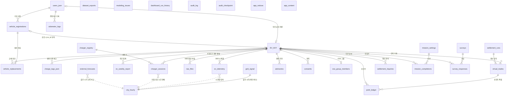
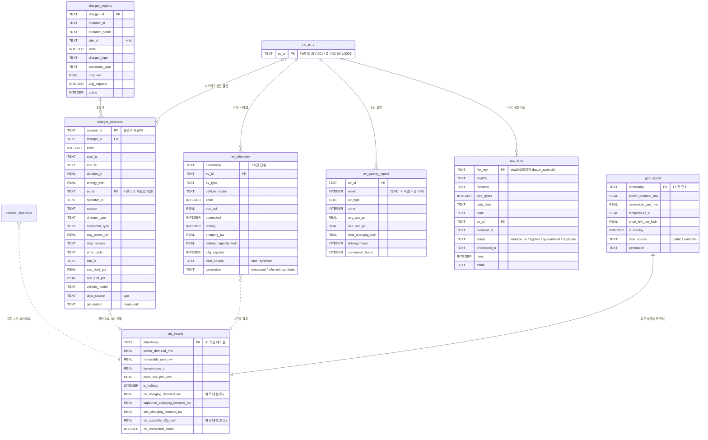
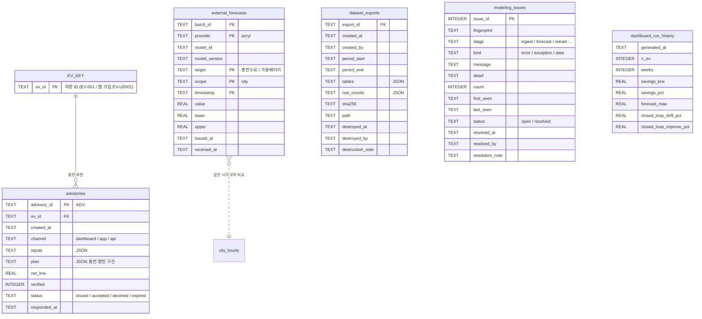
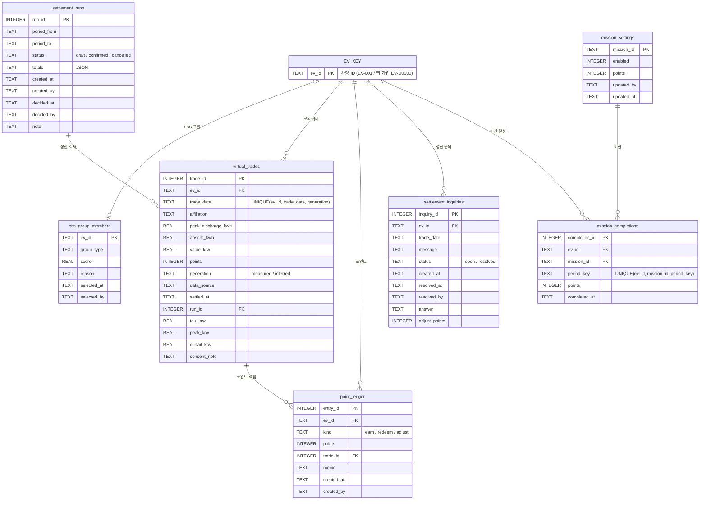
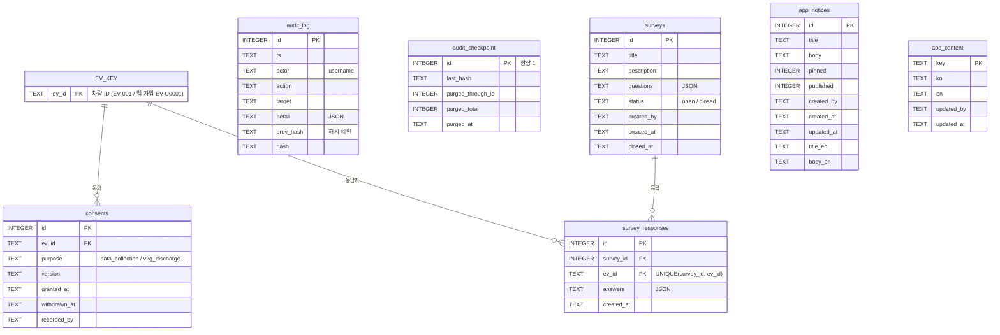

# AI-V2G DB 구조(ERD) v1.0

기준: 2026-11-25, 개발 서버(192.168.35.92) 실제 DB의 스키마와 소스 코드. 데이터 내용은 읽지 않았다.

## 1. 저장소 구성

| 파일 | 구분 | 담는 것 | 테이블 수 |
|---|---|---|---|
| `data/curated.db` | 운영 DB(SQLite) | 수집 데이터·AI 학습 테이블·추천·아크릴 연계·서포터즈·모의 정산/보상·예외 기록(+ schema_migrations) | 22 |
| `data/privacy.db` | 개인정보·감사 DB(SQLite) | 동의, 해시체인 감사로그, 설문, 앱 공지·문구 | 7 |
| `data/batch/batch_state.db` | OBD 배치 상태(SQLite) | 수신한 OBD 원본 파일의 처리 상태(중복·격리 판정) | 1 |
| `data/users.json` | 계정 저장소(JSON) | 로그인 계정·권한·차주 본인 차량 | - |
| `data/charge_tags.json` | 충전 인증 태그(JSON) | RFID/회원카드 태그 가명(PT-) ↔ 서포터즈 차량 | - |

## 2. ERD

점선 = 시각(timestamp)으로 결합하는 관계, 실선 = ID로 잇는 관계. `EV_KEY`는 공통 차량 ID(테이블 아님).

### 2-0. 전체 관계도(테이블 이름만)

### 2-1. 계정·서포터즈

```mermaid
erDiagram
    EV_KEY {
        TEXT ev_id PK "차량 ID (EV-001 / 앱 가입 EV-U0001)"
    }
    users_json {
        TEXT username PK "로그인 ID"
        TEXT password_hash "해시만 저장"
        TEXT role "admin / owner / viewer"
        TEXT owned_ev_id FK "차주 계정의 본인 차량"
        TEXT created_at
    }
    vehicle_registrations {
        TEXT registration_id PK
        TEXT username FK
        TEXT plate "마스킹 표시값"
        TEXT plate_enc "번호판 암호문"
        TEXT plate_hash "중복 확인용 해시"
        TEXT vehicle_model
        TEXT occupation
        TEXT region_sido
        TEXT region_sigungu
        TEXT departure_time "평소 출발 시각"
        REAL target_soc_pct "20~100"
        REAL min_soc_pct "10~90"
        REAL odometer_km
        TEXT status "pending / approved / rejected"
        TEXT ev_id FK "승인 시 부여"
        TEXT consent_version
        TEXT consented_at
        TEXT created_at
        TEXT reviewed_by
        TEXT reviewed_at
        TEXT reject_reason
        INTEGER reserve "예비 참여자"
        TEXT reserved_at
        TEXT reserve_note
        TEXT affiliation "private / public 등"
    }
    odometer_logs {
        TEXT username FK
        TEXT recorded_at
        REAL odometer_km
        TEXT source "signup / profile / app"
    }
    vehicle_replacements {
        INTEGER replacement_id PK
        TEXT inactive_ev_id FK "빠지는 차량"
        TEXT registration_id FK "투입되는 예비 신청"
        TEXT new_ev_id FK
        TEXT reason
        TEXT replaced_at
        TEXT replaced_by
    }
    charge_tags_json {
        TEXT tag_pseudo_id PK "PT- 가명 (태그 원문 미저장)"
        TEXT ev_id FK
        TEXT registered_at
        TEXT by
    }
    users_json ||--o{ vehicle_registrations : "가입 신청"
    users_json ||--o{ odometer_logs : "주행거리 기록"
    users_json |o--o| EV_KEY : "차주 본인 차량"
    vehicle_registrations |o--o| EV_KEY : "승인 시 ev_id 부여"
    vehicle_registrations ||--o{ vehicle_replacements : "예비 투입"
    EV_KEY ||--o{ vehicle_replacements : "교체 대상"
    EV_KEY ||--o{ charge_tags_json : "충전 인증 태그"
```

### 2-2. 수집 데이터(실측 연계 시 생성)

### 2-3. AI 예측·추천·운영

### 2-4. VPP 모의 정산·보상

### 2-5. 개인정보·감사·앱 운영(privacy.db)

## 3. 테이블 설명

### 계정·서포터즈

| 테이블 | 용도 |
|---|---|
| `users_json` | 로그인 계정. 비밀번호는 해시만, 차주 계정은 본인 차량(owned_ev_id)만 조회 |
| `vehicle_registrations` | 서포터즈 가입 신청·승인. 번호판은 암호문+해시, 승인 시 ev_id 부여, 예비 참여자 관리 |
| `odometer_logs` | 누적 주행거리 기록(가입·정정·앱 입력) |
| `vehicle_replacements` | 미활동 차량을 예비 참여자로 교체한 이력 |
| `charge_tags_json` | 충전 인증 태그 가명 ↔ 차량. 거점 세션을 서포터즈 차량에 결합할 때 사용(태그 원문 미저장) |

### 수집 데이터(실측 연계 시 생성)

| 테이블 | 용도 |
|---|---|
| `ev_telemetry` | 서포터즈 차량 OBD 1시간 시계열(SOC·연결·운행·충전 kW) |
| `charger_registry` | 연계 충전기 목록(운영사·거점·출력·V2G 가능) |
| `charger_sessions` | CPO 충전 세션. 서포터즈 차량이면 ev_id 결합, 거점 SOC·차종 포함 |
| `grid_signal` | 공공데이터 시간별 외부 변수(전력수요·재생에너지·기온·가격·공휴일) |
| `city_hourly` | AI 학습 테이블. 외부 변수 + 충전수요(서포터즈+거점) + 가용 배터리 |
| `ev_weekly_report` | 차량별 주간 운행·충전 요약 |
| `raw_files` | OBD 원본 파일 수신·처리 상태(batch_state.db) |

### AI 예측·추천·운영

| 테이블 | 용도 |
|---|---|
| `external_forecasts` | 아크릴 예측 수신값(배치·모델 버전·구간) |
| `advisories` | 차량별 충전(·방전) 추천과 차주 응답. 일 배치도 여기에 발행 |
| `dataset_exports` | 아크릴 학습 데이터 제공 이력(해시·파기 기록) |
| `modeling_issues` | 수집·예측·재학습 단계 예외 기록 |
| `dashboard_run_history` | 대시보드 재계산 시 핵심 지표 이력 |

### VPP 모의 정산·보상

| 테이블 | 용도 |
|---|---|
| `ess_group_members` | 이동형 ESS 그룹 선정 차량 |
| `settlement_runs` | 모의 정산 회차(초안·확정·취소) |
| `virtual_trades` | 차량·일자별 모의 거래(피크 방전·흡수, 금액, 포인트) |
| `point_ledger` | 포인트 적립·사용·조정 원장 |
| `settlement_inquiries` | 정산 문의와 답변·포인트 조정 |
| `mission_settings` | 미션 설정(포인트·사용 여부) |
| `mission_completions` | 차량별 미션 달성 |

### 개인정보·감사·앱 운영(privacy.db)

| 테이블 | 용도 |
|---|---|
| `consents` | 차량별 목적별 동의·철회(수집·V2G 방전 등) |
| `audit_log` | 해시체인 감사로그(조회·변경·추천 발행 등) |
| `audit_checkpoint` | 보존기간 지난 감사로그 정리 시 체인 이어붙이기 지점 |
| `surveys` | 설문 |
| `survey_responses` | 설문 응답(차량당 1회) |
| `app_notices` | 앱 공지(국·영문) |
| `app_content` | 앱 화면 문구(국·영문) |

## 4. 설계 메모

- 모든 차량 데이터는 **ev_id(차량 ID)** 한 키로 이어진다. 도표의 `EV_KEY`는 테이블이 아니라 이 공통 키를 나타낸다.
- SQLite에 외래키 제약(FOREIGN KEY)은 걸려 있지 않다. 관계는 코드에서 ID로 맞춘다(도표의 FK는 논리 관계).
- 점선 관계는 ID가 아니라 **시각(timestamp)으로 결합**하는 관계다: OBD·충전 세션을 시간별로 모아 city_hourly를 만들고, 아크릴 예측은 같은 시각 실측과 비교한다.
- 실증 데이터셋(1건 = 이벤트 × [① 차량·충전기 + ② AI 학습 블록])은 테이블로 저장하지 않고 ev_telemetry·charger_sessions·grid_signal에서 그때그때 만든다. 일 배치 결과는 data/batch/daily/<날짜>/dataset.csv(차량 ID 가명).
- 개발 서버 curated.db에는 지금 운영 테이블만 있다. ev_telemetry·charger_sessions·grid_signal·city_hourly·ev_weekly_report는 실측 수집(업로드·CPO 연계)이 시작되면 생긴다. 그 전에는 합성 데이터로 화면을 계산한다.
- 개인정보: 번호판은 암호문(plate_enc)+해시(plate_hash)로 저장, 충전 인증 태그 원문은 저장하지 않음, 외부 제공 시 ev_id는 PE- 가명으로 바꾼다.
- 스키마 버전은 schema_migrations(1~12)로 관리하고, 앱이 DB를 열 때 자동 적용된다(src/pipeline/migrations.py).
- data/backup/의 curated_before_reward_reset_*.db는 11-19 보상 초기화 전 백업으로, 구조는 curated.db와 같다.
- DB 밖 파일 저장소: 모델 레지스트리(data/models/), 배치 이력(data/batch/*.jsonl), 원본 수신 파일(data/raw/).
